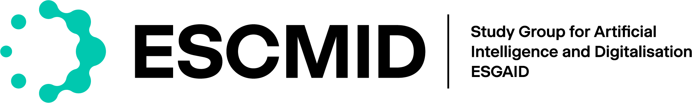

  <picture>
    <source media="(prefers-color-scheme: dark)" srcset="assets/esgaid-logo-dark.png">
    <source media="(prefers-color-scheme: light)" srcset="assets/esgaid-logo-light.png">
    
  </picture>

<h1 align="center">ESGAID on GitHub</h1>

  <em>The ESCMID Study Group for Artificial Intelligence and Digitalisation</em> 
  Optimising the implementation and use of artificial intelligence and data in clinical microbiology, 
  infectious diseases, hospital epidemiology and public health.

  <a href="https://www.escmid.org/esgaid/">Study group page</a> ·
  <a href="https://www.escmid.org/science-research/study-groups/">Join ESGAID</a> ·
  <a href="https://www.escmid.org/contact-study-group/?subject=3">Contact us</a>

---

## Welcome

This is the shared home for code, data standards, analyses and tools built by and with the ESGAID community. Whether you are a clinical microbiologist writing your first R script, an epidemiologist with a validated prediction model, or a developer working on laboratory interoperability, there is a place for your work here.

We built this organisation on a simple idea: too much good work in our field lives on a single laptop. Putting it in the open makes it reproducible, citable, reusable and much more fun to build on together.

## What we work on

ESGAID is organised around four expertise teams. Repositories here usually belong to one of them.

| Team | Focus |
|---|---|
| **I. Standardisation and interoperability** | FAIR data, terminologies and coding, laboratory data exchange, the European Health Data Space, reference implementations |
| **II. Digital access, equity and capacity building** | Lowering the barrier to digital methods across high-, middle- and low-income settings, teaching materials, training resources |
| **III. Generative AI and large language models** | LLMs for clinical microbiology and infectious diseases, prompt and evaluation frameworks, guardrails, benchmarking |
| **IV. AI, machine learning and other digital tools** | Prediction models, diagnostic and stewardship support, surveillance analytics, validation and reporting standards |

Cutting across all four: how to **develop, validate, report and implement** AI responsibly in clinical microbiology and infectious diseases, including study design, bias, interpretability, federated approaches, safety monitoring and real-world oversight.

## What you can share here

Anything that helps someone else do this work better:

- **Analysis code and notebooks** in R, Python, Julia, or whatever you use
- **Packages and libraries** for microbiology, resistance, surveillance or stewardship data
- **Models** with the code and documentation needed to evaluate them honestly
- **Data standards, mappings and schemas**, including terminology crosswalks
- **Teaching material**, workshops, tutorials and reproducible examples
- **Protocols, checklists and reporting templates** for AI studies in our field
- **Work in progress.** An unfinished repository that is open beats a finished one that is not.

## Starting a repository

Members of the organisation can create repositories directly. If you are not yet a member, open the [contact form](https://www.escmid.org/contact-study-group/?subject=3) with your GitHub username and a line about what you would like to share, and we will add you.

A few things that make a repository easy for others to pick up:

1. **A README that answers three questions:** what this does, how to run it, and who to ask.
2. **A licence.** Without one, nobody may legally reuse your work. MIT or Apache-2.0 for code, CC BY 4.0 for documents and data, GPL-3.0 if you want derivatives kept open.
3. **A `CITATION.cff` file** so your work is cited properly, and a DOI through [Zenodo](https://zenodo.org) when you release a version.
4. **Credit where it is due.** List contributors, and name the funders and institutions involved.

## Working with data

Our field works with sensitive material, so please take care:

- **Never commit patient-level or otherwise identifiable data**, not even pseudonymised, unless you have an explicit legal basis and approval to publish it. Git history is forever.
- **Never commit credentials**, connection strings, API keys or internal hostnames.
- Share **synthetic or aggregated example data** so others can run your code without needing your database.
- State the **provenance, licence and any data use agreement** for every dataset you do publish.
- Declare **conflicts of interest** and funding sources, as you would in a manuscript.

## Ground rules

We follow the ESCMID spirit of collegial, respectful and scientifically rigorous collaboration. Be kind in issues and reviews, assume good intent, and give credit generously. Repositories here are the responsibility of their maintainers; they represent the work of their authors, not formal ESCMID positions or guidance, unless explicitly stated.

## Current priorities

- Building an open overview of **who is doing what** in AI and digitalisation across our community
- Developing guidance on **how to validate and implement AI** for clinical microbiology and infectious diseases
- A **webinar and teaching series**, with the accompanying material shared openly

Want to help with any of these, or propose something else? Open an issue, or get in touch through the links below.

## Find us

- **Study group page:** <https://www.escmid.org/esgaid/>
- **Become a member:** <https://www.escmid.org/science-research/study-groups/>
- **Contact the executive committee:** <https://www.escmid.org/contact-study-group/?subject=3>
- **Newsletters, webinars and reports:** linked from the study group page
- **ESCMID:** <https://www.escmid.org>

  ESGAID is a study group of the European Society of Clinical Microbiology and Infectious Diseases (ESCMID), Basel, Switzerland.

